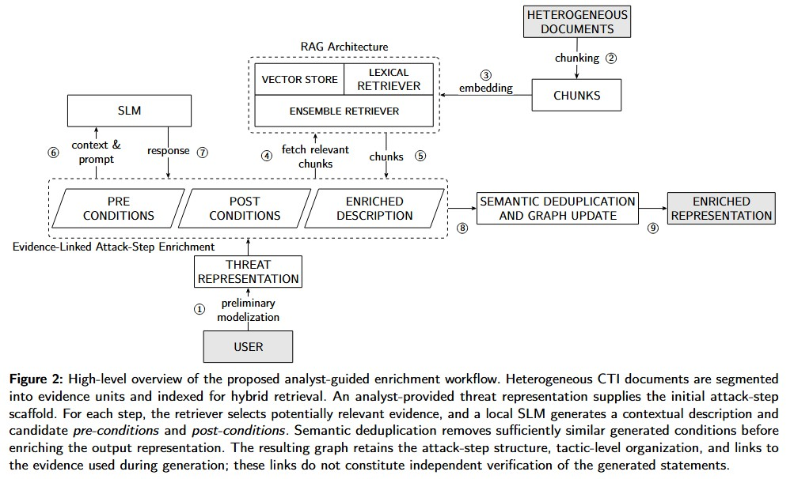

# Merging Cyber Threat Intelligence Through Retrieval-Augmented Generation and Small Language Models for Rich Threat Representation

This repository contains the source code, configuration, case-study data, generated outputs, and annotation material for the paper of the same title (submitted to the *Journal of Information Security and Applications*).

The pipeline takes an analyst-provided attack representation (STIX in our case studies) and a set of supporting Cyber Threat Intelligence (CTI) documents. For each attack step, it retrieves step-relevant evidence with a hybrid Retrieval-Augmented Generation (RAG) component and uses a locally deployed Small Language Model (SLM) to generate:

- an enriched, step-specific description;
- candidate **pre-conditions** (what must hold for the step to succeed);
- candidate **post-conditions** (what holds after the step succeeds);
- traceable links to the evidence chunks used for generation.

The enriched steps are organized into a graph that groups MITRE ATT&CK-aligned attack steps into tactic-level milestones. The whole pipeline runs locally: no CTI document is sent to external services.

[](https://doi.org/10.5281/zenodo.24463163)



## Repository structure

```
app2.py                      # Enrichment pipeline (entry point)
src/                         # Pipeline components
  DocumentFactory.py         #   document loading and semantic chunking
  STIXParser.py              #   STIX parsing (intermediate representation)
  group_attack_patterns.py   #   grouping of attack steps by tactic
  stores/DocumentStore.py    #   vector store (FAISS + sentence-transformers)
  retrieval.py, schemas.py   #   hybrid retriever used in the SQuAD tuning
  Custom*Loader.py, id_utils.py
configs/
  config.json                # Pipeline configuration (see below)
  annotation_guidelines/     # Guidelines given to the annotators
sample_stix/                 # Input STIX representation of each case study
documents/                   # Supporting CTI documents of each case study (zip)
mitre/mitre-tactics.json     # MITRE ATT&CK tactic order used for milestones
output/<case>/               # Pipeline outputs for the 10 case studies
evaluation/
  rag/squad/                 # Retrieval tuning on SQuAD (Appendix A of the paper)
  rag/results/squad_chunks/  # Tuning results and figures
  evaluation_outputs/        # Annotation units extracted from the outputs
  evaluation_final_metrics/  # Automatic metrics per case and overall
annotation_round_1/          # Annotator files, adjudication and agreement results
scripts/                     # Annotation preparation, agreement and statistics
figures/                     # Figures used in the paper
```

## Requirements

- Python 3.13 (tested with 3.13.1)
- [Ollama](https://ollama.com) with the generation model pulled:
  ```bash
  ollama pull deepseek-r1:8b
  ```
- [Git LFS](https://git-lfs.com): JSON, CSV and ZIP files are stored with Git LFS. Run `git lfs pull` after cloning.

Install the Python dependencies in a virtual environment:

```bash
python -m venv .venv
source .venv/bin/activate          # Windows: .venv\Scripts\activate
pip install -r requirements.txt
```

> **Note.** Semantic chunking requires the `chunking_evaluation` package (installed from GitHub by `requirements.txt`). If it is not available, `DocumentFactory` falls back to fixed-size splitting, which does not reproduce the paper's setting.

The experiments in the paper were run on a laptop with 32 GB of RAM and an Intel Core i7-14650HX CPU.

## Case studies

The evaluation uses ten public malware analysis reports published by the UK National Cyber Security Centre (NCSC):

| Case ID | Malware |
|---|---|
| `goofy` | Goofy Guineapig |
| `smooth` | Smooth Operator |
| `small_sieve` | Small Sieve |
| `jaguar` | Jaguar Tooth |
| `coldsteel` | COLDSTEEL |
| `umbrella` | Umbrella Stand |
| `pygmy` | Pygmy Goat |
| `authentic` | Authentic Antics |
| `damascened` | Damascened Peacock |
| `chipmunk` | Cheeky Chipmunk |

For each case, `sample_stix/<case>.json` is the input attack representation and `documents/<case>.zip` contains the supporting documents. Unzip the documents before running the pipeline.

## Running the pipeline

1. Edit `configs/config.json` for the case to process.
2. Make sure Ollama is running.
3. Run:
   ```bash
   python app2.py
   ```

The pipeline processes one case per run, as set by `CASE_ID` in the configuration.

### Configuration

Example configuration with the setting used in the paper:

```json
{
  "CASE_ID": "goofy",
  "STIX_FILE": "sample_stix/goofy.json",
  "DOCUMENTS_DIR": "documents/goofy",
  "OUTPUT_DIR": "output",
  "OUTPUT_FILE": "enriched_attack_graph.json",
  "MITRE_TACTICS_FILE": "mitre/mitre-tactics.json",
  "MODELS": {
    "TEXT_GENERATION": "deepseek-r1:8b",
    "SENTENCE_TRANSFORMER": "all-MiniLM-L6-v2"
  },
  "LLM": {
    "temperature": 0,
    "num_ctx": 16384
  },
  "RAG": {
    "bm25_k": 100,
    "vector_k": 50,
    "top_k": 50,
    "hybrid_alpha": 0.25
  },
  "CONDITIONS": {
    "duplicate_threshold": 0.7
  }
}
```

| Key | Description |
|---|---|
| `CASE_ID` | Identifier of the case; outputs are written to `OUTPUT_DIR/CASE_ID`. |
| `STIX_FILE` | Input attack representation. |
| `DOCUMENTS_DIR` | Folder with the supporting CTI documents (`DOCUMENTS_SUBDIR` optionally selects a subfolder). |
| `OUTPUT_DIR`, `OUTPUT_FILE` | Output folder and name of the enriched graph file. |
| `MITRE_TACTICS_FILE` | Tactic order used to build the milestones. |
| `MODELS.TEXT_GENERATION` | Ollama model used for generation. |
| `MODELS.SENTENCE_TRANSFORMER` | Embedding model for semantic duplicate removal (`MODELS.DUPLICATE_EMBEDDING` overrides it). |
| `LLM` | Ollama options: `temperature`, `num_ctx`, and optionally `top_p`, `repeat_penalty`, `num_predict`, `seed`. |
| `RAG.bm25_k`, `RAG.vector_k` | Candidates retrieved by the lexical (BM25) and vector retrievers. |
| `RAG.top_k` | Evidence chunks kept after weighted reciprocal rank fusion. |
| `RAG.hybrid_alpha` | Weight of the BM25 retriever; the vector retriever gets `1 - hybrid_alpha`. |
| `CONDITIONS.duplicate_threshold` | Cosine-similarity threshold for removing semantically duplicated conditions. |

Documents are chunked with semantic chunking (maximum 200 tokens, no overlap).

### Outputs

For each case, `output/<case>/` contains:

| File | Content |
|---|---|
| `enriched_attack_graph.json` | Enriched attack graph: milestones, attack steps, descriptions, pre-/post-conditions, evidence links |
| `metrics.json` | Automatic metrics (coverage, structure, provenance, runtime) |
| `errors.json` | Errors raised during generation, if any |
| `config_snapshot.json` | Configuration used for the run |
| `app.log` | Execution log |
| `chunks.jsonl` | Evidence chunks with stable identifiers |
| `retrieval_logs.jsonl`, `generation_logs.jsonl` | Per-step retrieval and generation logs |
| `generated_descriptions.jsonl`, `final_conditions.jsonl` | Generated descriptions and conditions after duplicate removal |
| `condition_duplicate_logs.jsonl` | Conditions removed as duplicates |

## Retrieval tuning on SQuAD

The retrieval hyperparameters were selected on SQuAD (Appendix A of the paper). Results are already in `evaluation/rag/results/squad_chunks/`. To reproduce them, run from the repository root:

```bash
python evaluation/rag/squad/chunks.py   # chunks, queries and relevance judgments from SQuAD
python evaluation/rag/squad/bm25.py     # BM25 at varying k
python evaluation/rag/squad/vector.py   # vector retriever at varying k
python evaluation/rag/squad/hybrid.py   # hybrid retriever at varying weights and k
python evaluation/rag/squad/plot_bm25.py \
  --csv evaluation/rag/results/squad_chunks/bm25_by_k.csv \
  --out evaluation/rag/results/squad_chunks/figures
python evaluation/rag/squad/plot_vector.py \
  --csv evaluation/rag/results/squad_chunks/vector_by_k.csv \
  --out evaluation/rag/results/squad_chunks/figures
```

## Manual evaluation

Two annotators independently assessed 860 generated conditions and 110 enriched descriptions. The guidelines are in `configs/annotation_guidelines/`; the annotation files, adjudication and agreement results are in `annotation_round_1/`.

| Step | Script |
|---|---|
| Extract annotation units from the outputs | `scripts/prepare_annotation.py` |
| Build the annotator packages | `scripts/prepare_annotation_packages.py` |
| Compare annotators and prepare adjudication | `scripts/prepare_adjudication.py` |
| Inter-annotator agreement | `scripts/agreement.py`, `scripts/agreement_details.py` |
| Scores and failure analysis | `scripts/stats.py`, `scripts/failure_stats.py`, `scripts/rag_qualitative.py` |
| Automatic metrics across cases | `scripts/aggregate_metrics.py` |
| Agreement figures | `scripts/plot/plot_pie_charts.py` |

Run `python <script> --help` for the options of each script.

## Citation

If you use this work, please cite:

```bibtex
@article{deidda2026merging,
  title   = {Merging Cyber Threat Intelligence Through Retrieval-Augmented Generation and Small Language Models for Rich Threat Representation},
  author  = {Deidda, Nicola and Regano, Leonardo and Sanna, Alessandro and Maiorca, Davide and Giacinto, Giorgio},
  journal = {Journal of Information Security and Applications},
  note    = {Under review},
  year    = {2026}
}
```

## License

The code in this repository is released under the [MIT License](LICENSE).

Third-party material keeps its original license: the NCSC malware analysis reports in `documents/` and the derived STIX files are © Crown copyright, and MITRE ATT&CK data is © The MITRE Corporation, used under the [ATT&CK Terms of Use](https://attack.mitre.org/resources/legal-and-branding/terms-of-use/).

## Contact

Nicola Deidda, University of Cagliari – nicola.deidda@unica.it